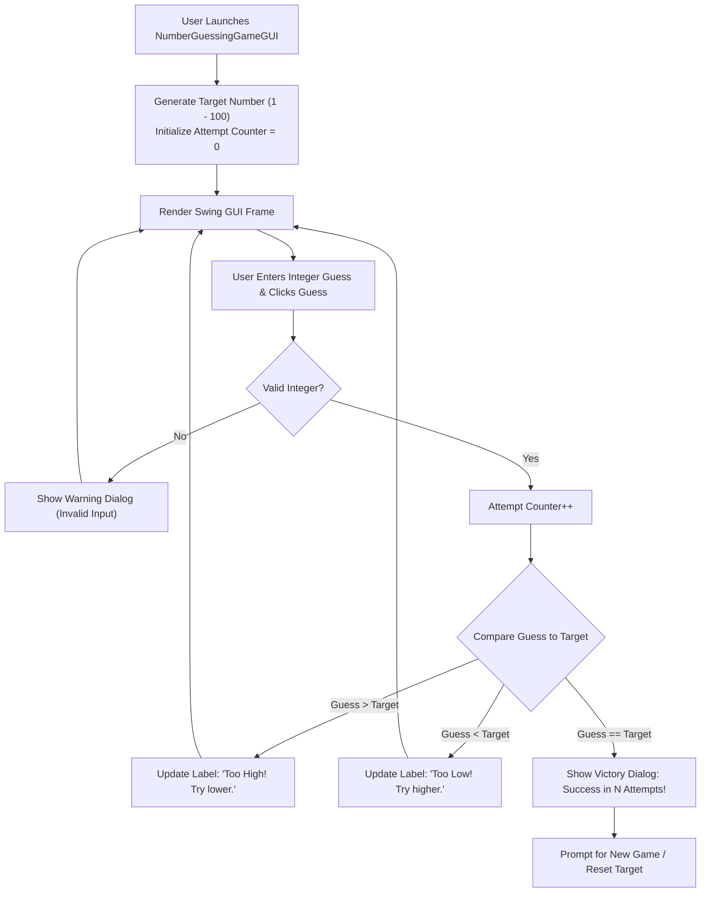

<p align="center">
  
</p>

<p align="center">
  
  
  
  
</p>

<a id="overview"></a>
## 📖 Executive Summary & Overview

Graphical User Interface (GUI) development in Java requires mastering the event-driven programming paradigm: managing asynchronous UI event dispatch threads (EDT), registering `ActionListener` callbacks, updating visual state, and gracefully handling invalid user inputs without terminating runtime threads.

The **Java GUI Number Guesser** (`GuessingGame`) is a standalone desktop application built using **Java Swing and AWT**. The game engine generates a pseudo-random integer within bounded limits, processes user guesses through an intuitive GUI, tracks attempt metrics in real time, and delivers instant visual hints ("Too High", "Too Low", or "Correct!").

<a id="toc"></a>
## 📑 Table of Contents

- [📖 Executive Summary & Overview](#overview)
- [🎯 Key Features & Capabilities](#features)
- [🏗️ System Architecture & Pipeline](#architecture)
- [🛠️ Tech Stack Breakdown](#tech-stack)
- [⚙️ Reproducible Quickstart & Setup](#setup)
- [📁 Project Directory Layout](#project-layout)
- [👨‍💻 Author & Contributions](#author)

<a id="features"></a>
## 🎯 Key Features & Capabilities

- **Event-Driven Swing Architecture:** Responsive GUI utilizing `JFrame`, `JPanel`, `JButton`, and `JTextField` components.
- **Real-Time Input Validation:** Exception trapping (`NumberFormatException`) preventing crashes on non-numeric inputs.
- **Dynamic Binary Search Hints:** Immediate comparative feedback guiding users toward target values using optimal search heuristics.
- **Session Reset & Metrics:** Attempt counter tracking player efficiency with single-click game restart capabilities.

<a id="architecture"></a>
## 🏗️ System Architecture & Pipeline



<a id="tech-stack"></a>
## 🛠️ Tech Stack Breakdown

| Component | Technology | Implementation |
| :--- | :--- | :--- |
| **Language** | Java (JDK 8 / 11 / 17+) | Core object-oriented language |
| **GUI Framework** | Java Swing (`javax.swing.*`) | `JFrame`, `JLabel`, `JButton`, `JOptionPane` |
| **Window Toolkit** | Java AWT (`java.awt.*`) | `FlowLayout`, `Font`, `Color` |
| **Randomization** | `java.util.Random` | Cryptographically uniform pseudorandom generation |

<a id="setup"></a>
## ⚙️ Reproducible Quickstart & Setup

### Prerequisites
- Java Development Kit (JDK 8 or newer)

```bash
# 1. Clone repository
git clone https://github.com/Amaraiah11/GuessingGame.git
cd GuessingGame

# 2. Compile Java GUI source
javac NumberGuessingGameGUI.java

# 3. Launch the desktop application
java NumberGuessingGameGUI
```

<a id="project-layout"></a>
## 📁 Project Directory Layout

```text
GuessingGame/
├── NumberGuessingGameGUI.java # Complete event-driven Swing game application
└── README.md                  # Comprehensive game architecture documentation
```

<a id="author"></a>
## 👨‍💻 Author & Contributions

This project is developed and maintained with high technical rigour by **Amaraiah C**, Software Engineer and Data Analytics Practitioner studying Bachelor of Computer Applications (BCA) at Alliance University.

- 🌐 **GitHub:** [@Amaraiah11](https://github.com/Amaraiah11)
- 💼 **LinkedIn:** [Connect on LinkedIn](https://www.linkedin.com/in/amaraiah-c/)
- 📧 **Institutional Contact:** `camaraiahBCA24@ced.alliance.edu.in`

### 🤝 Contribution Guidelines
Contributions, bug reports, and architectural discussions are welcome!
1. **Fork** the repository: `https://github.com/Amaraiah11/GuessingGame`
2. **Branch**: `git checkout -b feature/your-feature-name`
3. **Commit**: `git commit -m "feat: enhance feature logic"`
4. **Push**: `git push origin feature/your-feature-name`
5. **Open Pull Request** against the `main` branch.

---

<p align="center">
  <b>⭐ If this codebase or documentation assisted your engineering workflows, please star the repository! ⭐</b>
</p>

<p align="center">
  
</p>
