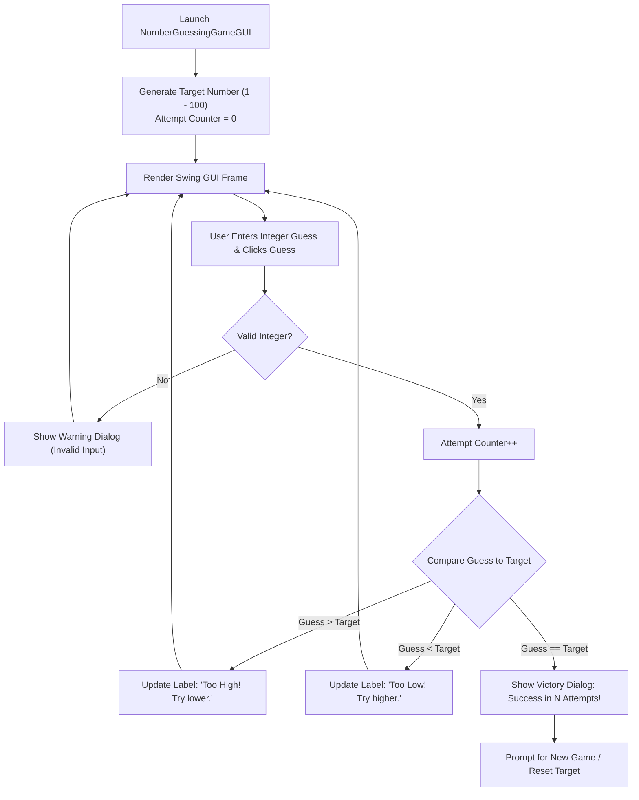

# 🎯 Java GUI Number Guesser — Interactive Swing Game Engine & Adaptive Feedback

<p align="center">
  
</p>

<p align="center">
  <b>Desktop GUI Game Engineering: Event Dispatch Thread (EDT) Management, Defensive Input Sanitization, and Binary Search Hint Mechanics.</b>
</p>

<p align="center">
  
  
  
  
</p>

<p align="center">
  
</p>

---

<a id="table-of-contents"></a>
## 📌 Table of Contents

- [📖 Executive Summary & Overview](#executive-summary--overview)
- [🎯 Key Features & Capabilities](#features)
- [🏗️ System Architecture & Pipeline](#system-architecture--pipeline)
- [🛠️ Tech Stack Breakdown](#tech-stack-breakdown)
- [⚙️ Reproducible Quickstart & Setup](#setup)
- [📁 Project Directory Layout](#project-layout)
- [🧪 Testing & Verification](#testing--verification)
- [🔮 Future Improvements & Roadmap](#future-improvements--roadmap)
- [🤝 Contributing Guidelines](#contributing-guidelines)
- [👨‍💻 Author & Contributions](#author--contributions)

---

<a id="executive-summary--overview"></a>
## 📖 Executive Summary & Overview

Graphical User Interface (GUI) development in Java requires mastering the event-driven programming paradigm: managing asynchronous UI event dispatch threads (EDT), registering `ActionListener` callbacks, updating visual state, and gracefully handling invalid user inputs without terminating runtime threads.

The **Java GUI Number Guesser** (`GuessingGame`) is a standalone desktop application built using **Java Swing and AWT** by **Amaraiah C**. The engine generates a pseudo-random integer within bounded limits, processes user guesses through an intuitive GUI, tracks attempt metrics in real time, and provides instant comparative feedback ("Too High", "Too Low", or "Correct!").

---

<a id="key-features--capabilities"></a>
## 🎯 Key Features & Capabilities

### 🖥️ 1. Event-Driven Swing Architecture
- Responsive desktop window using `JFrame`, `JPanel`, `JButton`, and `JTextField` components.

### 🛡️ 2. Defensive Input Sanitization
- Exception trapping (`NumberFormatException`) preventing application crashes on invalid or empty text inputs.

### 📊 3. Real-Time State Tracking
- Dynamic attempt counter tracking score efficiency alongside instant restart functionality.

---

<a id="system-architecture--pipeline"></a>
## 🏗️ System Architecture & Pipeline



---

<a id="tech-stack-breakdown"></a>
## 🛠️ Tech Stack Breakdown

| Component | Technology | Implementation |
| :--- | :--- | :--- |
| **Language** | Java (JDK 8 / 11 / 17 LTS) | Core object-oriented language |
| **GUI Framework** | Java Swing (`javax.swing.*`) | `JFrame`, `JLabel`, `JButton`, `JOptionPane` |
| **Window Toolkit** | Java AWT (`java.awt.*`) | `FlowLayout`, `Font`, `Color` |
| **Randomization** | `java.util.Random` | Pseudorandom integer generation within bounded ranges |

---

<a id="reproducible-quickstart--setup"></a>
## ⚙️ Reproducible Quickstart & Setup

### Prerequisites
- Java Development Kit (JDK 8 or higher)

```bash
# 1. Clone repository
git clone https://github.com/Amaraiah11/GuessingGame.git
cd GuessingGame

# 2. Compile Java GUI source
javac NumberGuessingGameGUI.java

# 3. Launch desktop application
java NumberGuessingGameGUI
```

---

<a id="project-directory-layout"></a>
## 📁 Project Directory Layout

```text
GuessingGame/
├── NumberGuessingGameGUI.java # Complete event-driven Swing game application
└── README.md                  # Comprehensive game architecture documentation
```

---

<a id="testing--verification"></a>
## 🧪 Testing & Verification

- Verified non-numeric inputs (e.g., `"abc"`, empty string) display informative warning dialogs without throwing exceptions.
- Verified target values remain strictly within $[1, 100]$ across multiple game resets.

---

<a id="future-improvements--roadmap"></a>
## 🔮 Future Improvements & Roadmap

- [ ] Add difficulty tiers: Easy ($1-50$), Medium ($1-100$), Hard ($1-1000$).
- [ ] Add persistent high-score leaderboard tracking minimal attempts.

---

<a id="author--contributions"></a>
## 👨‍💻 Author & Contributions

This project is developed and maintained with rigorous engineering standards by **Amaraiah C**, Software Developer and Applied Data Analytics Practitioner studying Bachelor of Computer Applications (BCA) at Alliance University, Bangalore.

- 🌐 **GitHub Profile:** [@Amaraiah11](https://github.com/Amaraiah11)
- 💼 **LinkedIn Profile:** [Connect on LinkedIn](https://www.linkedin.com/in/amaraiah-c/)
- 📧 **Institutional Email:** `camaraiahBCA24@ced.alliance.edu.in`

### 🤝 Contributing Guidelines
Contributions, bug reports, and architectural discussions are welcome!
1. **Fork** the repository: `https://github.com/Amaraiah11/GuessingGame`
2. **Create a Feature Branch:**
   ```bash
   git checkout -b feature/your-feature-name
   ```
3. **Commit Your Enhancements:**
   ```bash
   git commit -m "feat: enhance feature logic"
   ```
4. **Push to Your Branch:**
   ```bash
   git push origin feature/your-feature-name
   ```
5. **Open a Pull Request** against the `main` branch.

---

<p align="center">
  <b>⭐ If this codebase or documentation assisted your engineering workflows, please star the repository! ⭐</b>
</p>

<p align="center">
  
</p>
